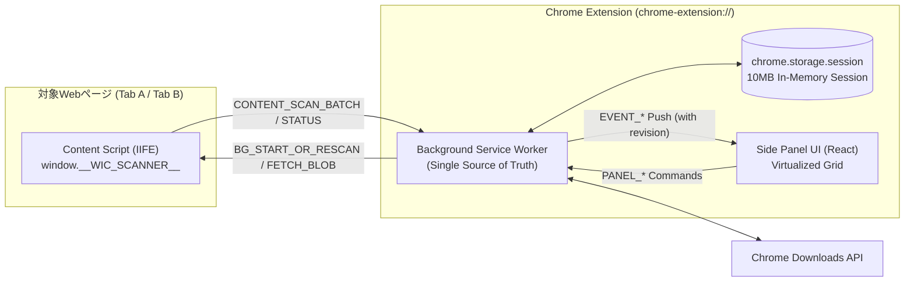
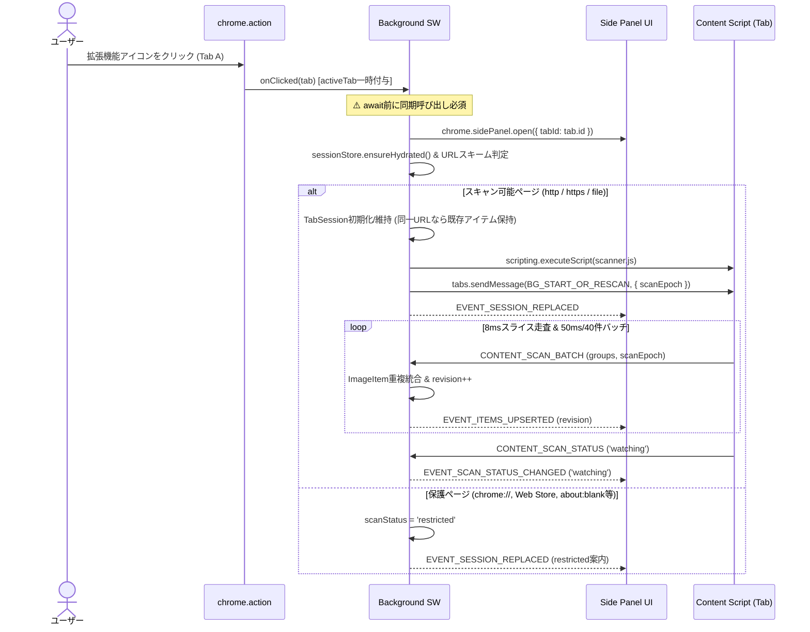
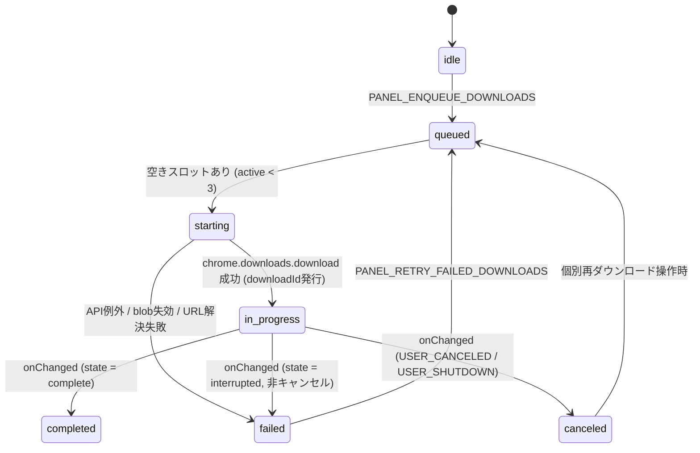

# HoiHoi コアアーキテクチャ設計書

> `spec.md`（MVP版 v1.1）を実装へ落とし込むための技術設計書。Chrome Manifest V3 特有の制約・権限モデル・非同期競合・データ構造など「設計を誤ると全体が破綻する重要箇所」を定義する。UIの細部や定型ロジックは本設計書と `src/shared/` の型契約に従って実装する。

---

## 1. 技術スタック・前提条件・仕様補正

### 都度実行の追加スキャン（仕様v1.2）

画像モード上部のクイックツールバーUIから寸法取得・自動スクロール・別ページ収集を明示開始する（トグル不要の1ステップ操作、長文説明はツールチップに格納し省スペース化）。通常スキャンで自動開始せず、設定を永続化しない。Panel → Background → Contentの専用Portを1回の実行に割り当て、所有パネルの切断・対象変更・再スキャンでAbortControllerを停止する。結果は既存の候補・寸法通知へ統合し、実行進捗だけを専用Portで返す。Backgroundは監視対象・ページURL・scanEpochを確認する。

`RawVariantCandidate` / `ImageVariant` の任意フィールド `sourcePageUrl` は別ページから集めた画像の取得元を保持する。保存時はこれをRefererに使い、通常画像はセッションのページURLを使う。DOMParserで取得HTMLを解析し、スクリプトを実行しない。上限と寿命は `performance.md` を参照。

汎用ページ送り検出は `shared/pagination-utils.ts` で、`rel=next/prev` またはページ送り欄内の番号・次/前リンクを、既知の数値クエリ・カーソル・`/page/N/` のURL構造と照合する。通常の記事IDなどは対象外。同一オリジン・同じURL構造・ページ送り以外の同一クエリ条件を固定し、実在リンクだけを追跡する。候補がない、または複数の構造が競合する場合は停止する。汎用画像抽出はmain領域を優先し、ナビゲーション・サイドバー等を除外する。v2phは専用の範囲判定・画像抽出ルールを引き続き使用する。

| 項目 | 選定内容 | 理由 |
| --- | --- | --- |
| パッケージ管理 | `pnpm` のみ（`AGENTS.md` 厳守） | `npm` / `yarn` / `bun` の使用は禁止 |
| ビルド構成 | Vite 6（2段構成：`vite.config.ts` + `vite.content.config.ts`） | Side Panel / SW は ESM、動的注入 Content Script は単一 IIFE として出力するため |
| UI / 仮想スクロール | React 19 + TypeScript (strict) + `@tanstack/react-virtual` | 数百〜2,000件のサムネイル一覧でメインスレッド詰まりを防ぐため（`spec.md` §2, §8.3） |
| テスト | Vitest | URL正規化・srcset解析・ファイル名サニタイズ・重複統合・キュー制御の単体検証用 |
| 最低Chromeバージョン | **Chrome 116**（`manifest.json` の `minimum_chrome_version: "116"`） | **【仕様補正】** `spec.md` §8.2 では暫定 114 とされていたが、同節注記の再確認方針に基づき、`action.onClicked` からプログラマティックに `chrome.sidePanel.open({ tabId })` を呼ぶ API が導入された **Chrome 116** を正式な下限とする |

### 構築済みの骨格ファイル（変更時は本設計書との整合を維持すること）

- `public/manifest.json` — 最小権限の MV3 マニフェスト（`host_permissions`・`tabs`・`content_scripts` なし）
- `vite.config.ts` / `vite.content.config.ts` — ESM + 単一IIFEの2段ビルド設定（`pnpm build` 動作確認済み）
- `src/shared/constants.ts` — 上限値・タイムスライス・許可リスト属性・ストレージキー定数
- `src/shared/types.ts` — 全コンテキスト共通ドメインモデル（`ImageItem`, `ImageVariant`, `TabSessionSnapshot` 等）
- `src/shared/messages.ts` — コンテキスト間通信の判別共用体（Discriminated Union）契約
- `src/background/index.ts`, `src/content/scanner.ts`, `src/sidepanel/{main,App}.tsx` — 必須ガードレール組み込み済みエントリ骨格

---

## 2. 絶対遵守ガードレール（実装AI向け7大禁止事項）

別のAIが実装を引き継ぐ際、以下のアンチパターンは Chrome MV3 の仕様上**確実に不具合を起こすため絶対に行わないこと**。

1. **【禁止】`openPanelOnActionClick: true` の使用、および `sidePanel.open()` 前の `await`**
   - `openPanelOnActionClick: true` にすると `chrome.action.onClicked` が発火しなくなり、`activeTab` 付与直後の自動スキャン注入ができなくなる。
   - `action.onClicked` リスナー内で `chrome.sidePanel.open({ tabId })` より前に `await` を1つでも挟むと、User Gesture コンテキストが失われて例外（`sidePanel.open() may only be called in response to a user gesture`）が発生する。
2. **【禁止】`manifest.json` への `host_permissions`・静的 `content_scripts`・`tabs` 権限の追加**
   - 初回インストール時に「全サイトのデータを読み取り変更する」警告が出るため AT-20 / MVP-20 違反となる。
3. **【禁止】Content Script の多重リスナー・多重 `MutationObserver` 登録**
   - `chrome.scripting.executeScript` はアイコンクリックや再スキャンのたびに同一ページで再実行されうる。必ず `window.__WIC_SCANNER__` シングルトンを経由し、リスナーと `MutationObserver` は1ページにつき1回だけ登録する（`spec.md` §8.3）。
4. **【禁止】Background Service Worker のメモリ変数のみへの依存、および非直列な `storage.session` 書き込み**
   - MV3 の Service Worker は約30秒のアイドルで強制終了する。また `SCAN_BATCH` や `downloads.onChanged` が並列到着した際に素朴な `get() -> 変更 -> set()` を行うと Read-Modify-Write 競合で状態が消失する。
5. **【禁止】巨大 `data:` URL の `chrome.storage.session` への丸ごと保存**
   - `chrome.storage.session` の上限は **10MB 固定**（`unlimitedStorage` でも拡張不可）。数MBの Base64 画像をそのまま保存すると `QUOTA_BYTES` 超過でタブ全体のセッション保存が失敗する。
6. **【禁止】ページ由来 `blob:` URL を Background SW から直接 `chrome.downloads.download` に渡すこと**
   - `blob:https://example.com/...` はオリジン隔離されているため、`chrome-extension://` オリジンの SW から直接ダウンロード要求を出すと失敗する。必ず §7.4 のオンデマンド解決フローを通すこと。
7. **【禁止】CSS表示サイズ（`el.width` / `getBoundingClientRect()`）を自然寸法として扱うこと、およびクエリ文字列の削除**
   - 寸法表示・寸法フィルターは自然寸法（`naturalWidth` / `naturalHeight`）のみを対象とする（`spec.md` §4.2）。URLの `?` 以降は署名やリサイズ指定を含むため絶対に削除しない（`spec.md` §6.4）。

---

## 3. 全体アーキテクチャとディレクトリ構成



### 推奨ディレクトリ構成（`[済]` = 作成済み、`[実装対象]` = 後続タスクで作成）

```text
src/
├── shared/
│   ├── constants.ts            [済] 閾値・許可リスト・ストレージキー定数
│   ├── types.ts                [済] ドメイン型定義
│   ├── messages.ts             [済] コンテキスト間メッセージ型契約
│   ├── url-utils.ts            [実装対象: Task S1] URL解決・スキーム検証・形式推定・srcset解析・リンク判定
│   └── filename-utils.ts       [実装対象: Task S1] ファイル名サニタイズ・重複回避名生成（Windows予約名対応）
├── content/
│   ├── scanner.ts              [済: 骨格] シングルトン制御・メッセージハンドラ（Task C1〜C3で中核接続）
│   ├── dom-extractor.ts        [実装対象: Task C1] 要素別の候補グループ抽出（img/picture/css-bg/svg/lazy/a.href）
│   ├── chunk-runner.ts         [実装対象: Task C2] 8msタイムスライス走査・バッチバッファ・MutationObserver
│   └── blob-reader.ts          [実装対象: Task C3] オンデマンド blob: → Data URL 変換（上限チェック付）
├── background/
│   ├── index.ts                [済: 骨格] トップレベルイベント登録・同期 sidePanel.open
│   ├── session-store.ts        [実装対象: Task B1/B2] タブ別状態管理・候補マージ・storage.session 直列永続化
│   ├── tab-coordinator.ts      [実装対象: Task B1] 起動・再スキャン注入・ナビゲーション検知・タブ閉鎖処理
│   └── download-manager.ts     [実装対象: Task B3] 同時3件キュー・blob解決連携・InterruptReason分類・再起動突合
└── sidepanel/
    ├── main.tsx                [済] エントリポイント
    ├── App.tsx                 [済: 骨格] 画面全体レイアウト・タブ状態分岐
    ├── hooks/
    │   ├── useActiveTabId.ts   [実装対象: Task U1] アクティブタブ追跡（tabs権限不要）
    │   └── useTabSession.ts    [実装対象: Task U1] Snapshot取得 + revision検証付きDelta購読・コマンド送信
    └── components/             [実装対象: Task U2〜U4] Header, FilterBar, SelectionToolbar, ImageGrid, ImageCard, DownloadFooter
```

**責務境界の原則**: Side Panel UI は `chrome.downloads` や `chrome.scripting` を直接呼ばず、必ず `PanelToBackgroundMessage` を通じて Background Service Worker にコマンドを送る。これにより、タブ切替やパネル開閉が起きても状態が一切分裂しない。

---

## 4. コア設計1：権限・起動・タブ分離ステートマシン（MVP-01, 18, 19, 20）

### 4.1 拡張機能アイコン起動シーケンス



### 4.2 タブ切替・ページ遷移・再スキャンの厳密な状態遷移

`tabs` 権限を持たない前提で、AT-18（タブ分離）と MVP-18（再スキャン統合）を以下のルールで実現する。

1. **Side Panel 側の表示対象タブ決定 (`useActiveTabId`)**:
   - マウント時に `chrome.tabs.query({ active: true, currentWindow: true })` で現在のウィンドウのアクティブ `tab.id` を取得する（`tabs` 権限なしでも `tab.id` と `tab.windowId` は常に取得可能）。
   - `chrome.tabs.onActivated` を購読し、自ウィンドウ（`activeInfo.windowId === currentWindowId`）のタブ切替が起きたら表示対象の `tabId` を即座に切り替える。
2. **未スキャンタブ（`scanStatus: 'unscanned'`）の表示**:
   - 切替先のタブBでまだ一度も拡張機能アイコンが押されていない場合、Background は空の初期スナップショット（`scanStatus: 'unscanned'`, `items: []`）を返す。
   - Side Panel はタブAの画像を絶対に残さず、**「このタブはまだスキャンされていません。ブラウザ右上の拡張機能アイコンをクリックしてスキャンを開始してください」** を表示する（※ Side Panel 内のボタンクリックでは Chrome 仕様上 `activeTab` が付与されないため、アイコンクリックを案内するのが正しい）。
3. **同一タブでのページ遷移検知 (`stale` 判定と `scanEpoch`)**:
   - `chrome.tabs.onUpdated` で `changeInfo.status === 'loading'` を検知した際、該当 `tabId` に既存セッションがあれば、ローディング完了後に Background から `tabs.sendMessage(tabId, { channel: 'WIC_BG_TO_CONTENT', type: 'BG_PING_CONTENT' })` を送る。
   - **応答なし**（別オリジンや新ドキュメントへ遷移して Content Script が消滅し、`activeTab` も失効した状態）：
     - 古いページの画像を誤って新ページのものと混同させないため、既存アイテムをクリア（進行中ダウンロードはそのまま継続）し、`scanEpoch` を `+1` した上で `scanStatus = 'stale'`（「ページが移動しました。拡張機能アイコンをクリックして再スキャンしてください」）へ遷移させる。
   - **応答あり・同一 `pageUrl`**：SPA内の軽微な更新とみなしセッション維持。
   - **応答あり・別 `pageUrl`（同一オリジンSPA遷移等）**：`pageUrl` と `domain` を更新して `scanEpoch` を `+1` し、古い画像をクリアして再スキャン可能にする。
   - すべての `CONTENT_SCAN_BATCH` は `message.scanEpoch === session.scanEpoch` を検証し、不一致の遅延バッチは破棄する。
4. **手動「再スキャン」ボタン（MVP-18）**:
   - `PANEL_TRIGGER_RESCAN` 受信時、既存 `items`・`selectedIds`・`downloads` は**消去せず維持**する。
   - まず既存 Content Script へ `BG_START_OR_RESCAN` を送信する。応答すればそのまま差分統合スキャンが走る。応答しない場合のみ `scripting.executeScript` を試行し、権限切れで失敗した場合は `scanStatus = 'stale'` にしてアイコン再クリックを案内する。
5. **タブ閉鎖時のクリーンアップ**:
   - `chrome.tabs.onRemoved(tabId)` でメモリと `chrome.storage.session` から `wic:tab_session_v1:<tabId>` を削除する。

---

## 5. コア設計2：画像候補グループ化・重複統合データモデル（MVP-02〜08, 11, 12）

### 5.1 2層データモデル（`ImageItem` × `ImageVariant`）の設計意図

「同一URLの重複排除（MVP-06 / AT-08）」と「カード単位の高解像度候補・リンク先候補の切替（MVP-04 / AT-02, AT-03）」と「フィルター・更新時の選択維持（MVP-09 / AT-12）」を同時に成立させるため、以下の不変条件を設ける。

- **カードの同一性 (`primaryUrl` による統合 + 不変の `itemId`)**:
  - DOM上の1つの画像出現箇所から `RawCandidateGroup`（代表URL `primaryUrl` ＋ 関連候補リスト `variants`）を抽出する。
  - Background は `primaryUrl` をキーとして `TabSession` 内で重複排除する。
  - 初出の `primaryUrl` にはタブ内で不変の `itemId`（例: `"item_1"`, `"item_2"`）を採番し、`selectedUrl = primaryUrl` で初期化する。
  - ユーザーがカード上で別候補（例: `srcset` の `2x` URL や `a.href` のリンク先URL）に切り替えた場合、`itemId` と `primaryUrl` は変えず **`selectedUrl` のみを更新**する。これにより選択状態（`selectedIds`）が絶対に壊れない。
- **候補ごとの独立メタデータ保持 (`ImageVariant`)**:
  - 各候補URLごとに `{ url, roles, descriptors, format, naturalWidth, naturalHeight }` を個別に保持する。
  - カードに表示しフィルター判定に使う寸法・形式は、現在選択中の `variant = item.variants.find(v => v.url === item.selectedUrl)` の値を参照する。これにより候補を切り替えても元の候補の自然寸法が上書き破壊されず、候補間の寸法比較（`spec.md` §6.3-4）もそのまま表示できる。

### 5.2 DOMソース別の抽出ルール (`src/content/dom-extractor.ts`)

| 対象要素 | 抽出ロジックとグループ化ルール |
| --- | --- |
| `` および `<picture>` | `` を起点に処理する（`<picture>` 単体では重複走査せず、`img.parentElement` が `<picture>` なら同 `<picture>` 内の全 `<source>` を同じグループに取り込む）。<br/>**`primaryUrl` 優先順位**: ① `img.currentSrc` → ② `img.getAttribute('src')` → ③ `LAZY_SRC_ATTR_ALLOWLIST` 先頭有効値 → ④ `srcset` / `data-srcset` / `<source srcset>` 先頭有効値。<br/>**自然寸法**: `img.complete && img.naturalWidth > 0` の場合、`img.currentSrc || resolvedSrc` に一致する候補へ `img.naturalWidth` / `img.naturalHeight` を記録する（未選択の `srcset` 候補には `img` の自然寸法を誤って付与しないこと！）。 |
| 祖先 `<a href>` | 上記 ``（または `<svg><image>`）から `el.closest('a[href]')` を辿り、解決後URLが `http:` / `https:` かつ `URL.pathname` の末尾が `LIKELY_IMAGE_PATH_EXTENSIONS`（`.jpg`, `.png`, `.webp`, `.avif` 等）に一致し、`primaryUrl` と異なる場合のみ `role: 'link-target'` として同グループの `variants` に追加する。「オリジナル」と断定せず UI 上は「リンク先候補」と表示する（`spec.md` §6.3）。 |
| CSS `background-image` | 全要素について `getComputedStyle(el).backgroundImage` を確認し、`"none"` 以外なら CSS `url(...)` トークンを抽出する（`linear-gradient(...), url("a.png"), url('b.png')` のような複数指定に対応するため、引用符付き・引用符なし・エスケープ文字を考慮したパーサーで全 `url()` を抽出）。各URLを独立した `RawCandidateGroup`（`source: 'css-bg'`）として発行する。`::before` / `::after` は初期版対象外（`spec.md` §6.2）。 |
| SVG `<image>` | `<svg>` 内の `image` 要素から `href.baseVal` または `getAttribute('href')` / `getAttributeNS('http://www.w3.org/1999/xlink', 'href')` を抽出し、`source: 'svg-image'` として発行する。 |
| 単体の遅延読込要素 | `` 以外でも `LAZY_SRC_ATTR_ALLOWLIST` 属性を持つ要素（例: `<div data-bg="...">` ではなく許可リスト内の `data-src` 等）があれば `source: 'lazy-attr'` として抽出する。許可リスト外の `data-*` は一切参照しない（MVP-03）。 |

### 5.3 URL解決・正規化・形式推定ルール (`src/shared/url-utils.ts`)

1. **URL解決とスキーム制限**:
   - `new URL(rawUrl.trim(), element.baseURI)` で絶対URLへ解決する。パース失敗時は破棄。
   - `ALLOWED_IMAGE_PROTOCOLS`（`http:`, `https:`, `data:`, `blob:`）以外はすべて除外する（`javascript:` 等を完全遮断）。
   - **クエリ文字列の保持**: `urlObj.search` は一切削除・改変しない（`spec.md` §6.4 / AT-09）。
2. **`srcset` パーサー注意点**:
   - **重要**: 画像URL自体にカンマが含まれる CDN URL（例: Cloudinary `https://res.cloudinary.com/.../w_400,c_scale/pic.jpg 400w, https://.../w_800,c_scale/pic.jpg 800w`）が存在するため、単純な `str.split(',')` はバグになる！
   - HTML仕様準拠のトークナイザ（先頭空白スキップ → 非空白URLトークン読取 → 末尾カンマ有無でディスクリプタ有無を分岐）で実装し、Vitest でカンマ入りCDN URLのテストを必ず書くこと。
3. **画像形式（`ImageFormat`）推定優先順位（追加HTTP通信なし）**:
   1. `data:image/<subtype>` の MIME（`image/jpeg` → `'jpeg'`, `image/svg+xml` → `'svg'` 等）
   2. `<source type="image/...">` の `mimeHint`
   3. `URL.pathname` の末尾拡張子（大文字小文字無視、`.jpg`/`.jpeg` → `'jpeg'`, `.tif`/`.tiff` → `'unknown'` または拡張定義外なら `'unknown'`）
   4. `URL.searchParams` の代表的フォーマット指定キー（`format`, `fm`, `ext` の値が既知形式名に完全一致する場合のみ）
   5. いずれにも該当しない場合は `'unknown'`（「不明」）とする。

### 5.4 重複統合（Merge）と `occurrenceCount` 二重計上防止

- Content Script 側で各要素に `WeakMap<Element, number>` でローカル要素ID（`el_1`, `el_2`, ...）を割り当て、`occurrenceKey = "${elementId}::${source}::${primaryUrl}"` を生成する。
- Background の `TabSession` は内部で `seenOccurrenceKeys: Set<string>`（メモリ保持、シリアライズ時は件数のみ永続化可）を持ち、未知の `occurrenceKey` のときだけ `item.occurrenceCount += 1` する。これにより、手動「再スキャン」や `MutationObserver` の再走査でも出現箇所数が水増しされない。

### 5.5 自然寸法の2段階補完と「寸法不明」フィルター仕様（MVP-08, MVP-11）

1. **第1段階**: Content Script で `img.naturalWidth > 0` が取れたものはスキャン時点で確定。また遅延ロード完了時に `document.addEventListener('load', onImgLoad, true)`（キャプチャフェーズ必須）で `CONTENT_IMAGE_LOADED_DIMENSIONS` を送り更新する。
2. **第2段階**: CSS背景画像や `srcset` 別候補など第1段階で `null` だったものは、Side Panel のサムネイル `` が `onLoad` した時点で `e.currentTarget.naturalWidth` / `naturalHeight` を読み取り、`PANEL_REPORT_THUMB_DIMENSIONS` で Background に反映する。
3. **寸法フィルター適用時のルール（MVP-11）**:
   - `minWidth` または `minHeight` が指定されているとき、選択中バリアントの寸法が `null` のアイテムは「条件適合を判定できない画像」となる。
   - デフォルトでは `FilterState.includeUnknownDimensions = false`（非表示）としつつ、フィルターバー直下に **「寸法不明のため判定できない画像が N 件非表示になっています ［寸法不明も表示する］」** の切替UIを必ず表示する。これにより AT-10 と MVP-11 を完全に満たす。

---

## 6. コア設計3：非ブロッキング段階スキャン & 冪等 Content Script（§6.5, §8.3, §9）

1. **チャンク分割走査 (`src/content/chunk-runner.ts`)**:
   - 初回・再スキャン時は `TreeWalker` を1ノードずつ進め、Open Shadow DOM、メタデータ、埋め込みスクリプト解析も同じランナーへ流す。`performance.now() - sliceStart >= SCAN_CHUNK_BUDGET_MS`（`8ms`）で中断し、`setTimeout(nextSlice, 0)` でメインスレッドを解放する。文書全体の配列スナップショットは作らない。
   - iframe 内ドキュメントおよび `::before` / `::after` 疑似要素は走査しない（`spec.md` §6.2）。
2. **バッチフラッシュと上限保護**:
   - 抽出した `RawCandidateGroup` はバッファに溜め、`SCAN_BATCH_MAX_SIZE`（`40件`）到達または `SCAN_BATCH_INTERVAL_MS`（`50ms`）経過で `CONTENT_SCAN_BATCH` を送信する。
   - 未応答のバッチは最大2件。応答待ち中は走査を休止し、応答イベントで再開する。待機中のポーリングは行わない。同一候補の再送も抑制する。
   - Background 側で `items.length >= MAX_ITEMS_PER_TAB`（`2,000件`）に達した場合は新規アイテム追加を打ち切り、`scanStatus = 'limit_reached'` を通知する。
3. **動的追加監視 (`MutationObserver`)**:
   - `observe(document.documentElement, { childList: true, subtree: true, attributes: true, attributeFilter: OBSERVED_MUTATION_ATTRIBUTES as string[] })` で監視する。
   - Observerのコールバックでは追加ノードの根と関連属性の変更対象のみを蓄積する。子孫走査は `150ms` の固定集約窓の後にランナーへ渡す。無関係なstyleアニメーションは無視し、連続変更でも処理が無期限に延期されない。待機ノードは4,000件までとし、溢れた場合は分割した全体走査へ集約する。

4. **監視の寿命とタブの限定**:
   - `usePanelActivity` が表示中パネルの対象だけを購読する。未スキャンのタブへの切替ではスキャンしない。ピン留め中はその対象を維持する。
   - パネルからContent Scriptへ直接接続した `SCANNER_LIFECYCLE` Portの最後の購読が切れたら、DOM/Performance Observer、ページイベント、待機タイマーを停止する。SWの寿命には依存しない。
   - Backgroundの `PanelSubscriptions` はウィンドウごとの購読を集約し、`webRequest` を対象タブの `tabId` フィルターで登録する。SW再起動時にはパネルがイベントで再購読し、最新Snapshotを受け取る。常時heartbeatは使用しない。
   - タイトル変更は購読中の既存セッションだけを更新する。無関係なタブの参照・タイトル変更でセッションを作成しない。

---

## 7. コア設計4：揮発性 SW 対策・10MBクォータ保護・ダウンロードキュー（§7, AT-13〜19）

### 7.1 Service Worker 状態復元と直列永続化 (`src/background/session-store.ts`)

- **Hydration ゲート**: セッションが必要な操作で `hydratePromise` を1度だけ実行する。保存済みデータを復元し、存在しないタブのキャッシュを削除する。無関係なタブのイベントでは復元しない。
- **Write Coalescing（競合防止）**:
  - 状態変更はすべて同期的にインメモリ `Map` を更新し、`revision` をインクリメントする。
  - 通常の保存はダーティフラグを立てて `750ms` の固定窓でまとめ、Promiseチェーンで直列実行する。同一候補・同一状態では更新しない。失敗した変更はダーティ状態を保持し、次の変更または明示flushで再試行する。パネルの最後の購読解除でもflushする。ダウンロードの重要インデックスは即時直列保存する。

### 7.2 `chrome.storage.session` 10MB クォータ保護戦略

1. **最重要インデックスのキー分離**:
   - `wic:active_downloads_v1`（`Record<downloadId, ActiveDownloadIndexEntry>`、数KB未満）と、タブ別データ `wic:tab_session_v1:<tabId>` を別キーで保存する。
2. **巨大 `data:` URL の退避**:
   - Content Script は `url.startsWith('data:') && url.length > INLINE_DATA_URL_SESSION_MAX_CHARS`（`32,768` 文字）の候補を検出した際、Content Script 内の `largeDataUrlStore: Map<string, string>` に全文を保持し、Background へ送る際は先頭MIMEヘッダ情報＋ハッシュ識別子（`largeDataRefId`）と短縮サムネイル用参照（または32KB以下の場合のみ全文）を付与する。
   - 万一 `chrome.storage.session.set` が `QUOTA_BYTES` エラーを投げた場合でも、メモリ上のセッションは維持しつつ古い非アクティブタブのキャッシュから順に `storage.session.remove` してリトライし、拡張機能全体が停止しないようにする。
   - 通常キャッシュは8タブ・保存Snapshotの推定6MiBを目安にLRU削除する。表示対象と実行中/待機中ダウンロードは保護する。候補メタデータはタブあたり推定2MiBで新規追加を制限し、候補数・派生URL・出現キーにも上限を設ける。捕捉フレームのData URLは永続Snapshotから除外する。
   - ページ内の巨大Data URLは合計16MiBまで保持し、同一URLに同じ参照を再利用する。参照を維持するため、単なる一時停止では保持し、セッションの退避またはページ破棄で解放する。

### 7.3 ダウンロードキューと状態遷移 (`src/background/download-manager.ts`)



- **同時実行制御**: 全タブ合計（またはタブ単位、初期値は拡張全体で `MAX_CONCURRENT_DOWNLOADS = 3`）で `starting` + `in_progress` の件数が `3` 未満の間、FIFO キューから順次取り出して開始する。
- **`chrome.downloads.download` 呼び出しオプション**:
  ```ts
  const downloadId = await chrome.downloads.download({
    url: downloadableUrl,
    filename: sanitizedRelativeFilename, // 安全なタイトル由来サブフォルダ + ファイル名
    conflictAction: 'uniquify',          // AT-17: 既存ファイルを上書きせず連番付与
    saveAs: false,
  });
  ```
  ※ `chrome.downloads.onDeterminingFilename` リスナーは登録しない（他拡張機能と競合して Chrome 全体のファイル名決定を壊す既知問題があるため、`download()` 引数の `filename` + `conflictAction: 'uniquify'` を使う）。

保存フォルダは `pageTitle` をそのままサニタイズする前に、`page-title-utils.ts` で独立したページ表記を除去する。`pageUrl` の既知のページ番号クエリまたは `/page/N/` と一致する番号だけを対象とし、オフセット・記事ID・番号が競合するURLは推測しない。表示・セッションの `pageTitle` は元の文字列を保持する。明示された `folderName` にはこの正規化を適用せず、従来のファイルシステム向けサニタイズのみを行う。画像・動画・キャプチャ画像・結合動画で同じ処理を使う。

### 7.4 `blob:` URL と巨大退避 `data:` URL のオンデマンド解決フロー

`starting` フェーズに入った対象 `targetUrl` が以下の場合のみ、Content Script と連携してから `chrome.downloads.download` に渡す。

1. **`targetUrl.startsWith('blob:')` の場合**:
   - Background SW から対象 `tabId` へ `BG_FETCH_BLOB_AS_DATA_URL`（上限 `BLOB_DOWNLOAD_MAX_BYTES = 25MB`）を送る。
   - Content Script はページオリジン内で `fetch(blobUrl)` → `blob()` → サイズ検証 → `FileReader.readAsDataURL` を実行し、Data URL を返す。
   - 成功すればその Data URL を `chrome.downloads.download` に渡して通常の `downloadId` 追跡に合流させる。
   - `fetch` 失敗（`URL.revokeObjectURL` 済み）、タブ閉鎖・別ページ遷移済み、またはサイズ超過の場合は即座に `status = 'failed'`, `errorCategory = 'blob_unreachable'`, `retryable = false` として「blob URLが失効しているか参照できないため保存できません」と記録し、キューの次へ進む（`spec.md` §6.4, §7.3）。
2. **`variant.largeDataRefId` を持つ退避済み巨大 `data:` URL の場合**:
   - Background SW メモリに実体がなければ Content Script へ `BG_RESOLVE_LARGE_DATA_URL` を問い合わせて実体文字列を取得し、`chrome.downloads.download` に渡す。

### 7.5 ファイル名生成・サニタイズ仕様 (`src/shared/filename-utils.ts`)

1. `http:` / `https:` URL の `pathname` 末尾セグメントを `decodeURIComponent`（失敗時は生文字列）して basename を得る。
2. basename が空、または `data:` / `blob:` URL の場合は `<sanitized-domain || 'page'>_<4桁ゼロ埋め連番>` をベース名とし、推定 `ImageFormat` に対応する拡張子（`jpeg`→`.jpg`, `'unknown'`→拡張子なしまたは `.bin` ではなく拡張子省略して Chrome の Content-Type 自動補完に委ねる）を付与する。
3. **OS横断サニタイズ（Windows対応必須）**:
   - 禁止文字 `[\\/:*?"<>|\x00-\x1f\x7f]` を `_` に置換。
   - 先頭・末尾の空白とドット `.` を除去。
   - ベース名（拡張子除く）が Windows 予約デバイス名（`/^(con|prn|aux|nul|com[1-9]|lpt[1-9])$/i`）に一致する場合は先頭に `_` を付与（例: `_con.jpg`）。
   - ベース名が `MAX_FILENAME_STEM_LENGTH`（`100` 文字）を超える場合は切り詰める。

### 7.6 エラー分類（`InterruptReason` マッピング）と再起動突合リカバリ

| Chrome `InterruptReason` / 内部コード | `status` | `errorCategory` | `retryable` | UI表示メッセージ方針（`spec.md` §7.3） |
| --- | --- | --- | --- | --- |
| `USER_CANCELED`, `USER_SHUTDOWN` | `canceled` | — | `false` | キャンセルとして集計（失敗再試行の対象外） |
| `NETWORK_FAILED`, `NETWORK_TIMEOUT`, `NETWORK_DISCONNECTED`, `SERVER_DOWN`, `SERVER_FAILED`, `CRASH` | `failed` | `network_transient` | `true` | 「ネットワークエラーまたは一時障害が発生しました（再試行可能）」 |
| `SERVER_BAD_CONTENT`, `NETWORK_INVALID_REQUEST` | `failed` | `not_found` | `true` | 「404 または URL が無効・失効している可能性があります」（自動再試行禁止） |
| `SERVER_UNAUTHORIZED`, `SERVER_FORBIDDEN`, `SERVER_CERT_PROBLEM`, `BLOCKED` | `failed` | `auth_or_forbidden` | `false` | 「認証またはアクセス権限が必要なため保存できませんでした」 |
| `BLOB_UNREACHABLE`（内部コード） | `failed` | `blob_unreachable` | `false` | 「blob URLの有効期限切れ、またはページ遷移により参照できません」 |
| `FILE_ACCESS_DENIED`, `FILE_NO_SPACE`, `FILE_NAME_TOO_LONG`, `FILE_BLOCKED`, `FILE_SECURITY_CHECK_FAILED`, `FILE_TOO_LARGE` | `failed` | `file_system` | `true` | 「保存先ファイルの書き込みまたはセキュリティ確認で失敗しました」 |
| その他未知コード | `failed` | `unknown` | `true` | 「ダウンロードに失敗しました（コード: `<reason>`）」 |

- **SW再起動・Side Panel再オープン時の突合（Reconciliation / AT-19）**:
  - `sessionStore.ensureHydrated()` 完了直後、および `PANEL_GET_TAB_SESSION` 応答前に、`ACTIVE_DOWNLOAD_INDEX` 内の全エントリについて `chrome.downloads.search({ id: entry.downloadId })` を実行する。
  - SW停止中に既に `state === 'complete'` または `'interrupted'` になっていたアイテムがあれば即座にステータスを更新し、待機中（`queued`）アイテムが残っていればポンプ処理を再開する。

---

## 8. コア設計5：Side Panel 自己修復型同期と UI 設計境界（MVP-09〜13, 17）

### 8.1 Snapshot + `revision` 付き Delta 同期 (`useTabSession`)

1. `tabId` が確定（または変化）したら `PANEL_GET_TAB_SESSION` を送り、`TabSessionSnapshot`（例: `revision: 12`）でローカル state を初期化する。
2. `chrome.runtime.onMessage` で `isBgToPanelEvent(msg)` かつ `msg.tabId === activeTabId` のイベントを受信する：
   - `msg.type === 'EVENT_SESSION_REPLACED'` → スナップショット丸ごと置換。
   - その他の差分イベント → **`msg.revision === currentRevision + 1` であれば差分適用**し、`currentRevision = msg.revision` に進める。もし `msg.revision !== currentRevision + 1`（イベント取りこぼし等）なら、即座に `PANEL_GET_TAB_SESSION` を再呼び出しして最新スナップショットで自己修復する。

### 8.2 フィルター・選択・カードUIの必須ルール

- **選択状態とフィルターの独立性（MVP-09, MVP-10, AT-12）**:
  - フィルターは Side Panel 側の `useMemo` で `items` を絞り込む純粋ビュー計算とする。
  - **「表示中を全選択」ボタン**: 現在フィルターを通過して画面に表示対象となっている `filteredItems.map(i => i.itemId)` を `mutation: { mode: 'add_many', itemIds }` で送る（全件選択と誤認されないようボタンラベルは必ず「表示中を全選択 (N件)」とする — `spec.md` §4.3）。
  - **「全解除」ボタン**: `mutation: { mode: 'clear_all' }` を送る。
  - **フィルター外選択の可視化**: `selectedIds` のうち現在フィルターで非表示になっている件数 `hiddenSelectedCount` が `1` 以上のとき、選択ツールバーに **「選択中: X件（うち非表示 Y件）」** と明示し、意図しない画像の保存を防ぐ。
- **カード操作のイベント伝播分離（`spec.md` §4.2）**:
  - カード内の「個別ダウンロード」「元画像を開く (`chrome.tabs.create({ url, active: false })` または `window.open`)」「URLコピー (`navigator.clipboard.writeText`)」「候補切替ドロップダウン」には必ず `e.stopPropagation()` を入れ、カードの選択チェック状態が誤って変化しないようにする。
- **サムネイル読込失敗時のフォールバック（`spec.md` §1, §4.2）**:
  - ``（または標準ポリシー）が `onError` になっても**カードを一覧から消去せず**、「プレビュー不可（CORS/保護）」のプレースホルダーアイコンと短縮URLを表示し、チェック選択・ダウンロード・URLコピーはそのまま操作可能にする。
- **行単位の仮想スクロール（`@tanstack/react-virtual`）**:
  - パネル幅を `ResizeObserver` で監視して列数 `columns`（例: 幅に応じて 2〜4 列）を算出し、`filteredItems` を `columns` 件ずつの「行（Row）」配列に分割した上で `useVirtualizer({ count: rowCount, estimateSize: () => ROW_HEIGHT, overscan: 3 })` により行単位で仮想描画する。

---

## 9. 別のAIへの実装委譲ガイド（タスク分割と受け入れテスト対応）

以下の順序でタスクを別のAIに依頼すると、手戻りなく段階的に完成・テストできる。各タスク依頼時は **「`spec.md`、`design.md`、および `src/shared/` の型定義を厳守して実装せよ」** と指示すること。

### Step 1: 共有純粋ロジックと単体テスト（最も独立性が高く軽量）

| タスクID | 作成・編集ファイル | 実装内容 | 対応要件・テスト |
| --- | --- | --- | --- |
| **Task S1** | `src/shared/url-utils.ts`<br/>`src/shared/filename-utils.ts`<br/>`src/shared/__tests__/*.test.ts` | ・`resolveAndValidateImageUrl`（相対解決・スキーム制限・クエリ保持）<br/>・`parseSrcset`（カンマ入りCDN URL対応）<br/>・`extractCssBackgroundUrls`（複数 `url()` 解析）<br/>・`isLikelyImageLinkHref`（拡張子判定）<br/>・`inferImageFormat`（MIME/hint/拡張子/クエリ推定）<br/>・`buildSafeDownloadFilename`（Windows予約名・禁止文字・長大名処理）<br/>・Vitest による境界値単体テスト作成・実行（`pnpm test`） | MVP-02〜04, 06, 08, 12<br/>AT-02〜05, 08, 09, 17 |

### Step 2: Content Script スキャナ実装（DOM/CSS検出）

| タスクID | 作成・編集ファイル | 実装内容 | 対応要件・テスト |
| --- | --- | --- | --- |
| **Task C1** | `src/content/dom-extractor.ts` | §5.2 に従い `img` / `picture` / CSS `background-image` / SVG `image` / 許可リスト遅延属性 / 祖先 `a.href` から `RawCandidateGroup` を抽出。32KB超 `data:` URL の `largeDataUrlStore` 退避対応 | MVP-02〜04, 08<br/>AT-01〜06 |
| **Task C2** | `src/content/chunk-runner.ts`<br/>`src/content/scanner.ts` | §6 に従い `8ms` タイムスライス走査、`40件/50ms` バッチ送信、`OBSERVED_MUTATION_ATTRIBUTES` 限定 `MutationObserver`（`150ms` デバウンス）、キャプチャ `load` イベントによる寸法追従を `scanner.ts` に接続 | MVP-05, 07, 18<br/>AT-07 |
| **Task C3** | `src/content/blob-reader.ts`<br/>`src/content/scanner.ts` | §7.4 に従い `BG_FETCH_BLOB_AS_DATA_URL` を処理するオンデマンド `blob:` → Data URL 変換（`25MB` 上限・失効エラー返却） | §6.4, §7.3 |

### Step 3: Background Service Worker 実装（状態管理・ダウンロードキュー）

| タスクID | 作成・編集ファイル | 実装内容 | 対応要件・テスト |
| --- | --- | --- | --- |
| **Task B1** | `src/background/session-store.ts`<br/>`src/background/tab-coordinator.ts`<br/>`src/background/index.ts` | §4, §5.4, §7.1〜7.2 に従い `ensureHydrated`、直列デバウンス永続化、候補重複マージ（`occurrenceKey` 重複防止）、アイコン起動時のスクリプト注入、ページ遷移 `BG_PING_CONTENT` 検証、`tabs.onRemoved` クリーンアップ | MVP-01, 06, 18〜20<br/>AT-08, 09, 18〜20 |
| **Task B2** | `src/background/index.ts`<br/>`src/background/session-store.ts` | Side Panel からの選択更新（`toggle_one`, `add_many`, `clear_all`）、候補切替（`PANEL_SELECT_VARIANT`）、サムネイル寸法補完（`PANEL_REPORT_THUMB_DIMENSIONS`）と `revision` 付き `EVENT_*` 配信 | MVP-04, 08〜10<br/>AT-02, 03, 12 |
| **Task B3** | `src/background/download-manager.ts`<br/>`src/background/index.ts` | §7.3〜7.6 に従い同時実行数3のダウンロードキュー、`ACTIVE_DOWNLOAD_INDEX` 即時永続化、`blob:` / 巨大 `data:` 解決連携、`InterruptReason` エラー分類、失敗再試行（`PANEL_RETRY_FAILED_DOWNLOADS`）、SW再起動時の `downloads.search` 突合 | MVP-14〜16<br/>AT-13〜17, 19 |

### Step 4: Side Panel UI 実装（React + 仮想スクロール）

| タスクID | 作成・編集ファイル | 実装内容 | 対応要件・テスト |
| --- | --- | --- | --- |
| **Task U1** | `src/sidepanel/hooks/useActiveTabId.ts`<br/>`src/sidepanel/hooks/useTabSession.ts` | §4.2, §8.1 に従いアクティブタブ追跡と Snapshot + `revision` 自己修復同期フック、各種操作アクション関数を実装 | MVP-07, 19<br/>AT-18, 19 |
| **Task U2** | `src/sidepanel/components/Header.tsx`<br/>`src/sidepanel/components/FilterBar.tsx`<br/>`src/sidepanel/components/SelectionToolbar.tsx` | ドメイン・件数・スキャン状態・再スキャンボタン、URL検索・最小幅/高さ・形式フィルター・寸法不明件数案内と表示トグル、「表示中を全選択(N件)」「全解除」「非表示選択数の内訳」「選択画像をダウンロード」 | MVP-09〜13, 18<br/>AT-10〜12 |
| **Task U3** | `src/sidepanel/components/ImageGrid.tsx`<br/>`src/sidepanel/components/ImageCard.tsx` | `@tanstack/react-virtual` 行仮想化グリッド、サムネイル描画（`onLoad` 自然寸法通知、`onError` プレースホルダー維持）、候補切替UI、出現数バッジ、個別保存・新タブ表示・URLコピー（トースト通知、`stopPropagation` 徹底） | MVP-04, 08, 17<br/>AT-01〜03 |
| **Task U4** | `src/sidepanel/components/DownloadFooter.tsx`<br/>`src/sidepanel/components/EmptyOrStatusView.tsx`<br/>`src/sidepanel/App.tsx` | 待機中/進行中/成功/失敗/キャンセル件数サマリー、失敗理由一覧と「失敗を再試行」ボタン、`unscanned` / `restricted` / `stale` / `limit_reached` 各状態の専用案内ビュー統合、CSSスタイリング仕上げ | MVP-01, 14〜16<br/>AT-13〜16, 18〜20 |

---

## 10. ビルド・動作確認コマンド

```powershell
# 依存パッケージのインストール（必ず pnpm を使用）
pnpm install

# 型チェック + 本番ビルド（dist/ 出力）
pnpm build

# 単体テスト実行
pnpm test
```

Chrome での読み込み手順：`chrome://extensions` を開き「デベロッパー モード」を有効化 →「パッケージ化されていない拡張機能を読み込む」から `dist` フォルダーを選択する。
